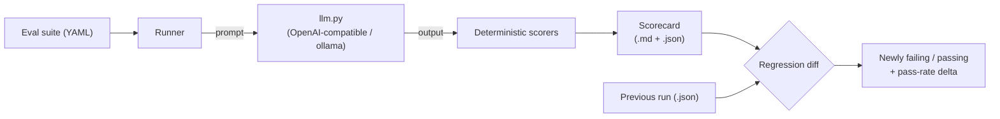

# llm-eval-harness

**Catch prompt/model regressions before your users do.** An offline-first evaluation
harness for LLM apps and prompts: define eval cases in YAML, score model output with
deterministic scorers, and diff two runs to see exactly what newly broke.

## The problem

You tweak a prompt or swap a model and "it seems fine." Then a week later a user hits
the one case you quietly broke. Eyeballing outputs does not scale and is not a gate.
This harness turns "seems fine" into a **pass rate** and a **regression diff** you can
put in CI, scored by rules you can read, not vibes.

## What it does

- **Suites in YAML** — each case has an `id`, a `prompt` (optional `$vars` templating), and a `scorer`.
- **Deterministic scorers** (the whole test gate): `exact_match`, `contains` / `contains_all` / `contains_any`, `regex`, `numeric` (within tolerance), `json_schema` (output must validate), `json_field_equals` (parse JSON, compare a field).
- **Optional `llm_judge`** scorer for open-ended answers — clearly labelled **AI-generated and advisory**, never part of the offline gate.
- **Runner** — calls the model under test through one thin OpenAI-compatible client (local ollama by default). If the model is unreachable, the affected cases fail cleanly; the run still finishes.
- **Scorecard** — Markdown + JSON, per-case pass/fail, overall pass rate, latency.
- **Regression diff** (the headline) — compare two run JSONs: newly failing, newly passing, added/removed cases, and pass-rate delta. Fully deterministic, no model needed.

## Architecture



## Quickstart

```bash
make install                 # venv + deps (PyYAML, jsonschema, pytest)
make test                    # offline gate: no network, no API key
make diff                    # regression diff of the two bundled example runs (offline)
make run                     # run the qa suite against your model (needs a reachable LLM)
```

No API key needed. `run` defaults to a local **ollama** at `http://127.0.0.1:11434/v1`
(configurable via `.env` — see `.env.example`). `test` and `diff` never touch the network.

## Sample run

Regression diff of two runs (this is `make diff`, works offline on bundled data):

```text
$ python -m eval_harness diff examples/run_baseline.json examples/run_new.json

# Regression diff: qa-basics

- Pass rate: 71.4% -> 75.0% (**+3.6 pts**)
- Newly failing (1): `water_formula`
- Newly passing (1): `boiling_point`
- Added cases: `mountain_height`
- Removed cases: _none_
```

`diff` exits non-zero when anything is newly failing, so it works as a CI gate.

A scorecard from `run` looks like this (illustrative, with a model connected):

```text
# Scorecard: qa-basics

- Pass rate: **85.7%** (6/7)
- Avg latency: 420 ms

| Case           | Scorer       | Result | Detail                         | Latency |
|----------------|--------------|--------|--------------------------------|---------|
| capital_france | contains     | PASS   | found substring 'Paris'        | 310 ms  |
| boiling_point  | numeric      | FAIL   | got 212.0, want 100.0+-2.0     | 480 ms  |

> Scores come from deterministic scorers (no AI judgement in this run).
```

## How it works

1. `suite.py` loads + validates a YAML suite (unique ids, known scorer types, required fields).
2. `runner.py` renders each prompt (`$var` templating), calls the model via `eval_harness/llm.py`, and times it. A model error becomes a failed case, not a crashed run.
3. `scorers.py` scores each output with a pure, deterministic function and returns `(passed, detail)`.
4. `scorecard.py` aggregates into a Markdown + JSON scorecard.
5. `regression.py` diffs two saved run JSONs by case id -> newly failing / passing + pass-rate delta.

The deterministic core (scorers, suite validation, aggregation, regression diff) is what
`pytest` covers, with the model mocked, so the gate runs with no network and no key.

## Honesty / safety

Outputs shown in scorecards are the model's own text. The `llm_judge` scorer is the only
AI-generated judgement; its rows are labelled **AI-GENERATED, ADVISORY** and a human must
review them. Deterministic scores are rules, not guarantees of correctness.

## Demo


See `DEMO.md` for a 60-second recording script.

## Tech stack

Python 3.10+, PyYAML, jsonschema, pytest. Model access via a ~50-line stdlib-only
OpenAI-compatible client (`eval_harness/llm.py`); defaults to local ollama.

## License

MIT (c) 2026 Al Amin Bashir Afara — see [LICENSE](LICENSE).
